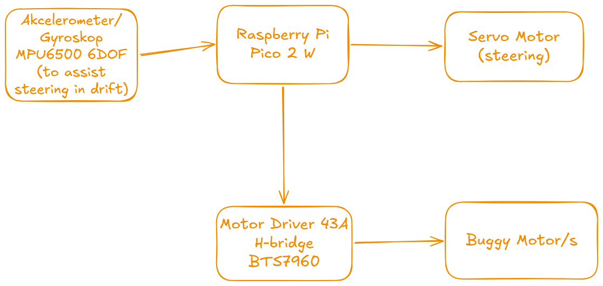

# RC Drifting with LEGO® Technic Powered By Raspberry Pi 

I had problem with official LEGO® Technic Powered Up Hub because it don't support high current output to drivetrain motors. Usually they have built-in current protection or other type of limit. So this open-source project covers how to create your own controller for LEGO® Technic RC Car, it can be usefull for those who want to create such controller from scratch, with components they can buy online. During my progress I will update this repository with guidance, schematics and parts list.

## Parts

| Part | Job | Cost |
|------|-----|----------|
| [Raspberry Pi Pico 2 W](https://techfun.sk/produkt/raspberry-pi-pico-2-w/) | Main controller | 9.95€ |
| [Geekservo 360° servo](https://www.hwkitchen.cz/geekservo-2kg-360-kompatibilni-s-lego/?srsltid=AYCX9vLu5DXDNZYzeMQKfClUsgtHx309jbL6yrICD3vhBzDSBX9wzFc0) | Steering | 10.92€ |
| [BTS7960 H-bridge](https://techfun.sk/produkt/vykonny-motor-driver-43a-h-bridge-bts7960/) | Drives the motors | 7.8€ |
| [Buggy motors](https://www.aliexpress.com/item/1005007223314670.html?spm=a2g0o.order_list.order_list_main.48.13571802zKtUCM) | Drive | 6€  |
| [MPU6500 6DOF](https://techfun.sk/produkt/akcelerometer-gyroskop-mpu6500-6dof/) | Gyro for drift steering assist | 2.8€ |
| [Step Down Buck](https://techfun.sk/produkt/step-down-menic-mini-360-mp2307-3a/) | Regulates power from battery to rest of system | 0.95€
| [Battery](https://www.rcprofi.sk/p/li-ion-sada-7-4-v-2600-mah-15c-s-konektorom-xt60?utm_campaign=nezarazeno_28&utm_content=KONECT&utm_id=PM-IM-KN-LI0742600-XT60&utm_medium=product&utm_source=heureka.sk&hgtid=5c65fb3e-8710-4f8d-94e9-5d001a8bbed2) | 7.4V 2600mAh 15C Li-ion battery | 25.19€
| | Connectors, wires etc. | 2€

Total cost of system: 40€ (without battery)

Note: If you want to make sure that you won't get surprised by faulty component, order 2 of all components except Raspberry and battery. One of mine motor drivers was broken for example.

## Ultimate Goal

- An Xbox Elite Series 2 controller connects to the Pico 2 W over Bluetooth ([Bluepad32](https://github.com/ricardoquesada/bluepad32)).
- A Geek servo steers.
- Buggy motors (unofficial) drive the car through a BTS7960 H-bridge.
- Current protection, its level configurable by firmware.
- An MPU6500 gyro support drifting.

## Configuration

Settings to adjust for your car. They are in `firmware/src/`. Rebuild and
flash after a change.

### Motor

| Setting | File | Now | What it does |
| --- | --- | --- | --- |
| `MOTOR_DIRECTION` | `motor.c` | −1 | `1` or `-1`. Flip if the right trigger drives backwards. |
| `DRIVE_OUTPUT_CAP` | `drive.h` | 100 | Hard limit on motor power, %. Lower it (e.g. 50) for a slower car. |
| `DRIVE_POWER_MIN` | `drive.h` | 75 | Power level after arming, %. `B` here stops. |
| `DRIVE_POWER_MAX` | `drive.h` | 100 | Highest power level (`A` steps, `LB`+`RB` jumps), % |
| `DRIVE_POWER_STEP` | `drive.h` | 5 | `A` / `B` change the power level by this, % |

### Steering

| Setting | File | Now | What it does |
| --- | --- | --- | --- |
| `SERVO_CENTER_US` | `servo.c` | 1500 | Servo pulse for wheels straight. Adjust if the car pulls to one side. |
| `SERVO_RANGE_US` | `servo.c` | 373 | Steering angle. Full stick = center ± this. 373 ≈ 67° on a 360° servo (~5.6 µs per degree). |
| `SERVO_DIRECTION` | `servo.c` | 1 | `1` or `-1`. Flip if the stick steers the wrong way. |
| `STEER_DEADZONE` | `drive.h` | 10 | Stick % treated as center |
| `STEER_EXPONENT` | `drive.h` | 3 | Steering curve. 1 = linear, 2 = finer near center, 3 = finer still (half stick = 12 %). |

### Gyro (drift assist)

All in `assist.h`. How to tune: [DRIVING.md](DRIVING.md#drift-assist-gyro).

| Setting | Now | What it does |
| --- | --- | --- |
| `ASSIST_YAW_SIGN` | −1 | `1` or `-1`. Flip if the wheels turn *with* the car when you rotate it by hand. Check this first. |
| `ASSIST_GAIN_DEFAULT` | 0.40 | How hard the gyro counter-steers against rotation. Tune with D-pad up/down (±0.05, saved). Twitchy or wobbling: lower it. |
| `ASSIST_HOLD_GAIN` | 0.50 | Heading hold: how hard it steers back to the last heading. 0 = plain rate mode. Wobble on the straight: lower it. |
| `ASSIST_HOLD_RELEASE` | 1.0 | How fast steering sets a new heading. 1 = full stick sets it at once. |
| `ASSIST_MAX` | 50 | Max gyro correction, steering %. Below 100, so the gyro never fully overrides you. |
| `ASSIST_STICK_PRIORITY` | 1.0 | The more you steer, the less the gyro does. 1 = full stick turns it off. Lower = gyro stays stronger while you steer. |
| `ASSIST_FREE_YAW` | 0 | Rotation (°/s) always allowed. 0 = gyro opens every slide. Raise it (e.g. 60) to leave light drifts to you. |
| `ASSIST_FILTER_ALPHA` | 0.85 | Smoothing, 0–1. Lower = smoother but slower to react. |

## Docs

- [WIRING.md](WIRING.md): how the Pico 2 W build is wired (pins, power, parts).
- [KNOWLEDGE.md](KNOWLEDGE.md): wiring, power and safety lessons from the first build.
- [DRIVING.md](DRIVING.md): arming, throttle, ramps, failsafe and drift assist.
- [firmware/README.md](firmware/README.md): the Pico firmware (controller pairing so far).

Toolchain: C with the [Pico SDK](https://github.com/raspberrypi/pico-sdk) 2.1.1 and [Bluepad32](https://github.com/ricardoquesada/bluepad32) 4.2.0, built with CMake. See [AGENTS.md](AGENTS.md#building-and-flashing-the-pico-2-w).
